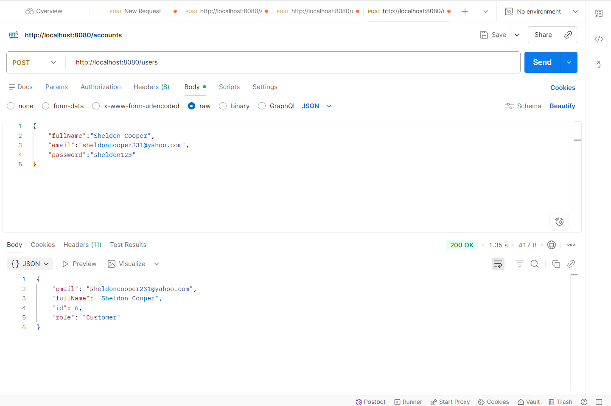

# 🏦 Banking Platform

> **Project Status:** 🟢 Active Development

A production-ready Banking Backend developed using **Java 17**, **Spring Boot**, **Spring Security (JWT)**, **PostgreSQL**, and **Docker**.

This project demonstrates modern backend development practices by implementing secure REST APIs, layered architecture, JWT-based authentication, database persistence, OpenAPI documentation, Docker containerization, and environment-specific configuration using Spring Profiles.

The project is being continuously enhanced and will gradually evolve into a complete Microservices-based Banking Platform with Redis, Kafka, API Gateway, Kubernetes, and CI/CD.

---

# 🎯 Project Goal

The primary objective of this project is to build a production-oriented backend application while following industry-standard development practices.

Instead of creating a simple CRUD application, this project focuses on:

- Secure Authentication & Authorization
- Clean Layered Architecture
- REST API Design
- Containerization using Docker
- Environment-based Configuration
- Database Integration
- API Documentation
- Scalability & Future Migration to Microservices

---

# ✨ Features

- Secure JWT-based Authentication & Authorization
- User Registration & Login APIs
- Account Management
- Transaction Management
- Spring Security Integration
- PostgreSQL Integration using Spring Data JPA
- Layered Architecture
- Global Exception Handling
- Bean Validation
- Swagger / OpenAPI Documentation
- Dockerized Deployment
- Multi-container Setup using Docker Compose
- Spring Profiles for Environment-specific Configuration

---

# 🛠 Tech Stack

| Category | Technology | Version |
|-----------|------------|---------|
| Language | Java | 17 |
| Framework | Spring Boot | 4.0.6 |
| Security | Spring Security | 4.0.6 |
| Authentication | JJWT | 0.12.7 |
| Database | PostgreSQL | 17 |
| ORM | Spring Data JPA | 4.0.6 |
| API Documentation | SpringDoc OpenAPI | 3.0.2 |
| Build Tool | Maven | 3.9.11 |
| Containerization | Docker Engine | 29.6.1 |
| Orchestration | Docker Compose | v2 Plugin |

---

# 🏗 Architecture

The application follows a layered architecture to ensure separation of concerns and maintainability.

```
                   Client
                      │
                      ▼
              REST APIs (HTTP)
                      │
                      ▼
       Spring Security (JWT Filter)
                      │
                      ▼
               Controller Layer
                      │
                      ▼
                Service Layer
                      │
                      ▼
             Repository Layer
                      │
                      ▼
                 PostgreSQL
```

📌 A detailed architecture diagram will be added under the **docs/** folder.

---
# 📷 Screenshots

## Swagger UI


[Swagger](screenshots/swagger-ui2.png)

---

## Docker Containers


---

## Login API



# 📂 Project Structure

```
src
├── controller
├── service
├── repository
├── entity
├── dto
├── security
├── config
├── exception
└── resources
```

### Folder Responsibilities

| Folder | Responsibility |
|----------|----------------|
| controller | REST API Endpoints |
| service | Business Logic |
| repository | Database Operations |
| entity | JPA Entity Classes |
| dto | Request & Response Objects |
| security | JWT Authentication & Authorization |
| config | Spring Configuration |
| exception | Global Exception Handling |
| resources | Application Configuration |

---

# 🚀 Running the Application Locally

## Clone Repository

```bash
git clone https://github.com/aftab-gits/banking-platform.git

cd banking-platform
```

## Build Project

```bash
mvn clean package
```

## Run Application

```bash
mvn spring-boot:run -Dspring-boot.run.profiles=local
```

---

# 🐳 Running with Docker

The project supports one-command deployment using Docker Compose.

```bash
docker compose up --build
```

This automatically starts:

- Banking Platform Application
- PostgreSQL Database
- Docker Network

using the **Docker Spring Profile**.

---

# 📖 API Documentation

Interactive API documentation is available after starting the application.

```
http://localhost:8080/swagger-ui.html
```

---

# 🔐 Security

The application uses **JWT (JSON Web Token)** based authentication.

Authentication Flow:

```
User Login
      │
      ▼
Authentication
      │
      ▼
Generate JWT Token
      │
      ▼
Client Stores Token
      │
      ▼
Authorization Header
      │
      ▼
JWT Filter
      │
      ▼
Protected REST APIs
```

---

# 📷 Screenshots

The following screenshots will be added soon:

- Swagger UI
- Docker Compose Running
- PostgreSQL Container
- Postman API Responses
- Project Architecture

---

# 🚀 Future Roadmap

## ✅ Completed

- Spring Boot Monolithic Backend
- JWT Authentication & Authorization
- PostgreSQL Integration
- Docker
- Docker Compose
- Spring Profiles
- Swagger Documentation

## 🔄 In Progress

- Migration to Microservices Architecture

## 📌 Planned

- API Gateway
- Eureka Service Discovery
- OpenFeign
- Redis Caching
- Apache Kafka
- Event-Driven Architecture
- Resilience4j
- Distributed Configuration
- Kubernetes Deployment
- GitHub Actions CI/CD Pipeline
- AWS Deployment

---

# 📚 Learning Outcomes

This project demonstrates practical implementation of:

- Java Backend Development
- REST API Design
- Spring Boot
- Spring Security
- JWT Authentication
- Spring Data JPA
- PostgreSQL
- Docker
- Docker Compose
- Spring Profiles
- Layered Architecture
- Production-oriented Backend Development

---

# 👨‍💻 Author

**Aftab Ahmed**

Java Backend Developer

GitHub:
https://github.com/aftab-gits

---

## ⭐ If you found this project helpful, consider giving it a Star.